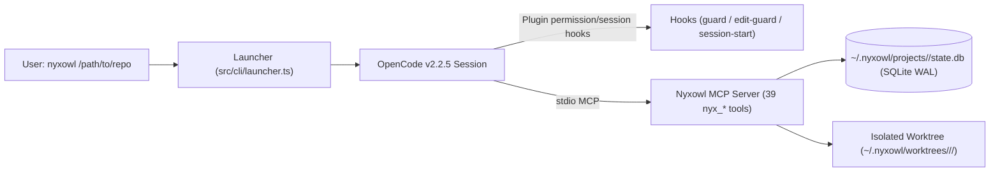

# Nyxowl System Architecture

## 1. High-Level Overview

Nyxowl consists of three tightly integrated subsystems:
1. **Core & State Layer (`src/core/`, `src/mcp/db/`):** Zero-native-addon SQLite WAL state engine (`node:sqlite`), HMAC-SHA256 receipt signer, Exact-Value + Entropy Redactor, token budgeter, and Git temporary-index worktree manager.
2. **8-Engine Heavy Runtime MCP Server (`src/mcp/engines/`):** 39 deterministic tools (`nyx_*`) exposed over stdio MCP (`nyxowl mcp`) with strict Zod input/output schemas, MCP annotations, schema-safe token-budget truncation + recoverable overflow artifacts, and `audit_log` recording.
3. **Universal CLI, Compiler, Hooks & OpenCode Adapter (`src/cli/`):** Compiles canonical Markdown agents (`agents/primary/`, `agents/subagents/`) and 11 authored skill packages (`agents/skills/<agent-id>/`) into the session-scoped OpenCode v2.2.5 package under `~/.nyxowl/hosts/opencode/`. Ten skills are native (copied to `hosts/opencode/skills/`, advertised by absolute root, loaded on demand); `nyx-testwriter` is inline (embedded in its system prompt). The TUI launches with the generated `opencode.json` via `opencode --standalone <path>`; OpenCode manages its own service and MCP connections.

---

## 2. State Isolation (`~/.nyxowl/`)

All Nyxowl state lives outside the user's repository in `~/.nyxowl/` (`0700`, overrideable via `NYXOWL_HOME`):
- `secrets/receipt.key` (`0600`): 32-byte random key used for HMAC-SHA256 receipt signing.
- `hosts/opencode/`: Generated session-scoped OpenCode config, agents, commands, and the copied `skills/` root.
- `hosts/opencode-plugin/`: Generated OpenCode plugin that registers the permission and session hooks.
- `worktrees/<repo-id>/<slug>/`: Default external Git worktrees so the user's main checkout stays untouched and clean.
- `projects/<repo-id>/state.db`: Per-repository SQLite database in `WAL` mode (`busy_timeout = 5000`, `BEGIN IMMEDIATE` write transactions) shared across all worktrees of the same repository via `git rev-parse --git-common-dir`.

---

## 3. Shadow Checkpoints & 3-Strike Circuit Breaker

- `nyx_slice_checkpoint` snapshots the entire worktree (including untracked non-ignored files) using a temporary `GIT_INDEX_FILE` (`git read-tree HEAD && git add -A && git write-tree && git commit-tree`) stored at `refs/nyxowl/slices/<slug>/<seq>`. It never pollutes `HEAD`, the real Git index, or commit history.
- `nyx_verify_slice` normalizes compiler/test error output (stripping timestamps, PIDs, port numbers, and temp paths) and hashes the error signature into the `strikes` table:
  - **Strikes 1–2:** Returns reduced failure output to the writer role.
  - **Strike 3:** Automatically rewinds the worktree to the latest shadow slice via `nyx_slice_rewind` (`read-tree` + `checkout-index -a -f` + `git clean -fd`, preserving `.env` symlinks and `node_modules`) and requires escalation to `nyx-architect`.
  - **2 Failed Escalations:** Triggers `ERR_DOOM_LOOP_ESCALATION` to halt execution and report evidence to the user.

---

## 4. Grammar Integrity & Bounded Scanning

Engine 2's tree-sitter path treats grammar files as a supply-chain boundary:

- Seven vendored grammars are supported: Python, Go, Rust, Java, Ruby, PHP, and C# (`tree-sitter-{python,go,rust,java,ruby,php,c_sharp}.wasm`).
- `data/grammars/manifest.json` pins `version: 1` plus the byte length and SHA-256 of each vendored `.wasm`.
- The manifest is read from the same directory as the grammar, so `NYXOWL_GRAMMARS_DIR` overrides must ship matching pins.
- Grammar bytes are read once, checked for size and digest, and the verified `Uint8Array` is handed directly to `Parser.Language.load`. A missing/invalid manifest, missing entry, size mismatch, hash mismatch, or read error returns `null` and the caller uses the legacy regex outline. Unverified bytes are never loaded.
- Loaded languages are memoized by grammar path plus verified digest (FIFO, max 32 entries).

Parsing and skeleton extraction are bounded before recursion:

- Sources over 2,000,000 characters are not parsed.
- An iterative AST pre-walk rejects trees deeper than 200 or larger than 50,000 named nodes, so recursive extractors cannot overflow the call stack; callers fall back to the legacy outline.
- `nyx_symbol_skeleton` stats files before reading and rejects files over 2 MiB or 50,000 lines with `ERR_FILE_TOO_LARGE`.
- Skeleton results are cached FIFO with a 256-entry cap.

Coverage gates are enforced per glob in addition to the global thresholds: `src/core/**` and `src/mcp/engines/**` require at least 85% lines and 85% branches, `src/cli/**` requires at least 75% lines and 75% branches, and the whole tree keeps 80% statements/functions and 65% branches.

Version reporting in the MCP server, bootstrap commit trailers, and PR footer is sourced from `NYXOWL_VERSION` (`src/core/version.ts`), which resolves `package.json` at runtime.

---

## 5. Gate Evidence, Coverage, and Isolation

- **Schema-safe truncation:** every tool response validates against its advertised output schema. When the serialized output exceeds the resolved budget (tool override > role override > global default), the full payload is stored as an overflow artifact and the bounded preview names the artifact id in `content` text; `structuredContent` is never extended with `_truncated` or `_overflowArtifactId`.
- **Seam source boundary:** the seam scanner enumerates `git ls-files -co --exclude-standard` when available and always prunes a central generated-directory registry (`.next`, `out`, `build`, `.output`, `.nuxt`, `.svelte-kit`, `.turbo`, `.vercel`, `.cache`, `target`, `bin`, `obj`, `__pycache__`, `.pytest_cache`, `.mypy_cache`, `.venv`, `venv`, coverage, and similar). Env drift is deduplicated by key and large mismatch sets are summarized.
- **Server-side seams:** extractors cover `"use server"` actions, server components/loaders, Supabase `.from()`/`.rpc()`, Prisma, Drizzle, and raw SQL, mapped against migration tables and RPCs. Layers that are absent are reported as unchecked; layers that are present but unsupported are reported with a reason.
- **Fail-closed exploit preflight:** a target must return 2xx for a known route before vectors run. Connection refusal, timeout, redirects, 4xx/5xx, and env/proxy rejection produce RED/INCONCLUSIVE evidence with coverage `none`; a GREEN exploit receipt requires an exercised surface.
- **Browser/e2e and ports:** `nyx_verify_slice` can run a configured e2e command with package-level env loaded only into child processes, on a freshly allocated loopback port, with process-group teardown on every exit path. Explicit occupied ports fail closed.
- **Receipt coverage honesty:** receipts may carry signed `coverageNotes` and `limitations`. The PR table prints the actual coverage (`full`, `partial`, `none`) or `not reported`, never a fabricated `full`, and renders the notes verbatim with a not-fully-verified caveat when a relevant surface was not exercised.
- **Order independence:** verify snapshots untracked files before running and removes generated build/e2e artifacts it created, so `verify → seam` and `seam → verify` bind the same tree hash.
- **Model preflight:** `nyx_model_preflight` resolves role → provider → model → variant against the supported non-pro roster and known variant sets, failing loudly with the available variants rather than substituting a model or a free variant.
- **CI parity:** `nyx_verify_slice` reads `.github/workflows/ci.yml` and runs the same safe local package-script commands CI runs (typecheck, lint, test/test:coverage, build, skills, agents). A gate can no longer pass locally while the CI coverage job fails.
- **Gate runner and freshness:** `nyxowl gate-run --info` compares the running MCP marker (`run/mcp-server.json`: pid, version, tool count, entry) with the current worktree build and reports stale reasons; `nyxowl gate-run --tool <name> --args '<json>'` runs a gate against the current build in-process, bypassing a stale host process.
- **PR CI observation:** `nyx_worktree_pr` returns the PR number, check-rollup status, individual checks, and a CI notice; `waitForChecks` polls to a terminal state. `gh pr edit` failures fall back to a REST `PATCH` against the pull request using the gate-generated body.
