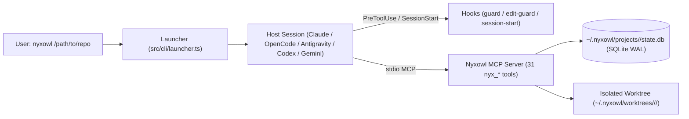

# Nyxowl System Architecture

## 1. High-Level Overview

Nyxowl consists of three tightly integrated subsystems:
1. **Core & State Layer (`src/core/`, `src/mcp/db/`):** Zero-native-addon SQLite WAL state engine (`node:sqlite`), HMAC-SHA256 receipt signer, Exact-Value + Entropy Redactor, token budgeter, and Git temporary-index worktree manager.
2. **7-Engine Heavy Runtime MCP Server (`src/mcp/engines/`):** 31 deterministic tools (`nyx_*`) exposed over stdio MCP (`nyxowl mcp`) with strict Zod input/output schemas, MCP annotations, token budget truncation + overflow artifacts, and `audit_log` recording.
3. **Universal CLI, Compiler, Hooks & Host Adapters (`src/cli/`):** Compiles canonical Markdown agents (`agents/primary/`, `agents/subagents/`) and DNA-conditional skills (`agents/skills/registry.json`, `skills-vendor/`) into session-scoped host packages under `~/.nyxowl/hosts/<host>/`.

---

## 2. State Isolation (`~/.nyxowl/`)

All Nyxowl state lives outside the user's repository in `~/.nyxowl/` (`0700`, overrideable via `NYXOWL_HOME`):
- `secrets/receipt.key` (`0600`): 32-byte random key used for HMAC-SHA256 receipt signing.
- `hosts/<host>/`: Generated session-scoped host configurations, plugins, prompts, and skills.
- `worktrees/<repo-id>/<slug>/`: Default external Git worktrees so the user's main checkout stays untouched and clean.
- `projects/<repo-id>/state.db`: Per-repository SQLite database in `WAL` mode (`busy_timeout = 5000`, `BEGIN IMMEDIATE` write transactions) shared across all worktrees of the same repository via `git rev-parse --git-common-dir`.

---

## 3. Shadow Checkpoints & 3-Strike Circuit Breaker

- `nyx_slice_checkpoint` snapshots the entire worktree (including untracked non-ignored files) using a temporary `GIT_INDEX_FILE` (`git read-tree HEAD && git add -A && git write-tree && git commit-tree`) stored at `refs/nyxowl/slices/<slug>/<seq>`. It never pollutes `HEAD`, the real Git index, or commit history.
- `nyx_verify_slice` normalizes compiler/test error output (stripping timestamps, PIDs, port numbers, and temp paths) and hashes the error signature into the `strikes` table:
  - **Strikes 1–2:** Returns reduced failure output to the writer role.
  - **Strike 3:** Automatically rewinds the worktree to the latest shadow slice via `nyx_slice_rewind` (`read-tree` + `checkout-index -a -f` + `git clean -fd`, preserving `.env` symlinks and `node_modules`) and requires escalation to `nyx-architect`.
  - **2 Failed Escalations:** Triggers `ERR_DOOM_LOOP_ESCALATION` to halt execution and report evidence to the user.
